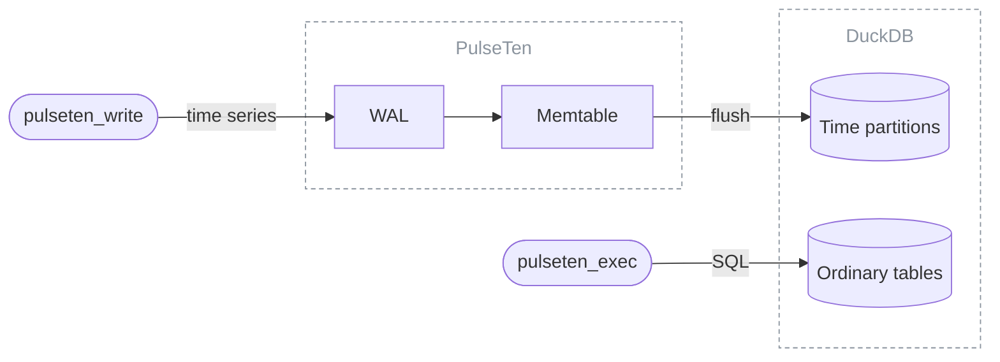

<div align="center">

<h1>PulseTen</h1>

<p><b>The embedded time-series database built on DuckDB.</b></p>

<p>
<a href="https://github.com/leviathan0992/pulseten/actions/workflows/ci.yml"></a>
<a href="LICENSE"></a>
</p>

<p>English | <a href="README.zh-CN.md">简体中文</a></p>

<br>


</div>

## Overview

PulseTen is an embedded time-series database built on [DuckDB](https://duckdb.org). Time-series data is written through a native time-series API, and ordinary DuckDB tables are read and written through a SQL interface.
Like SQLite, it runs inside the application process, with no separate server to deploy.

## Highlights

- **Time-series and relational.** Metrics land in time-series tables; hosts, devices and other reference data live in ordinary tables with ACID transactions. Joining them requires no data movement.
- **Real-time.** Writes are queryable as soon as they return; every query reads stored and in-memory data as one consistent snapshot.
- **Time partitioning.** Time-series data is organized into hour-aligned partitions. Queries prune partitions outside their time range, and retention drops expired partitions whole.
- **Compact storage.** Flushed data is kept in DuckDB's columnar format, where each column is compressed with lightweight encodings such as RLE, bit-packing, dictionary/FSST and ALP for floating-point values.
- **Crash recovery.** Time-series writes are group-committed to a write-ahead log and replayed on open. Optional WAL sync makes each write durable before it returns.
- **Embeddable.** A single header and a self-contained static library. Ships with native Go bindings.

## Architecture



Time-series writes are appended to a write-ahead log and buffered in a columnar memtable, which a background thread flushes into hour-aligned DuckDB partitions. Ordinary tables are native DuckDB tables. Each query runs in DuckDB against one consistent snapshot of the partitions, the ordinary tables and the memtable.

## Example

```cpp
#include "pulseten.h"

#include <cstdio>

int main() {
  pulseten_db_t *db = nullptr;
  pulseten_open("./metrics", nullptr, &db);

  /* Relational data in an ordinary table. */
  pulseten_exec(db,
                "CREATE TABLE hosts (host VARCHAR PRIMARY KEY, region VARCHAR);"
                "INSERT INTO hosts VALUES ('web-1', 'us-east');");

  /* Time-series data: cpu,host=web-1 usage=12.5 at 2026-01-01 00:00 UTC.
  The cpu table and its columns are created by the write itself. */
  pulseten_tag_t   tag   = {"host", 4, "web-1", 5};
  pulseten_field_t field = {"usage", 5, PULSETEN_TYPE_DOUBLE, {.m_double = 12.5}};
  pulseten_point_t point = {1767225600000000LL, &tag, 1, &field, 1};
  pulseten_write(db, "cpu", &point, 1);

  /* One query over both, including the write just made. */
  pulseten_result_t *result = nullptr;
  pulseten_query(db,
                 "SELECT h.region, avg(c.usage) "
                 "FROM cpu c JOIN hosts h USING (host) "
                 "WHERE c.time >= TIMESTAMP '2026-01-01' "
                 "GROUP BY h.region",
                 &result);

  uint32_t n = 0;
  while (pulseten_result_fetch(result, &n) == PULSETEN_OK && n > 0) {
    for (uint32_t r = 0; r < n; r++) {
      printf("%s %.2f\n", pulseten_result_varchar(result, 0, r, nullptr),
             pulseten_result_double(result, 1, r));
    }
  }

  pulseten_result_destroy(result);
  pulseten_close(db);

  return (0);
}
```

The same flow in Go:

```go
db, err := pulseten.Open("./metrics", nil)
if err != nil {
	return err
}
defer db.Close()

if err := db.Exec(`CREATE TABLE hosts (host VARCHAR PRIMARY KEY, region VARCHAR);
                   INSERT INTO hosts VALUES ('web-1', 'us-east');`); err != nil {
	return err
}

if err := db.Write("cpu", pulseten.Point{
	Time:   time.Now(),
	Tags:   []pulseten.Tag{{Name: "host", Value: "web-1"}},
	Fields: []pulseten.Field{{Name: "usage", Value: 12.5}},
}); err != nil {
	return err
}

rows, err := db.Query(`SELECT h.region, avg(c.usage)
                       FROM cpu c JOIN hosts h USING (host)
                       GROUP BY h.region`)
if err != nil {
	return err
}
defer rows.Close()

for rows.Next() {
	fmt.Println(rows.String(0), rows.Float64(1))
}
return rows.Err()
```

See [examples/quickstart.cc](examples/quickstart.cc) for a complete program with error handling.

## Building

Requires CMake 3.24+, Ninja and a C++20 compiler. Tested on Linux and macOS.

```bash
git submodule update --init third_party/duckdb
cmake -S . -B build -G Ninja -DCMAKE_BUILD_TYPE=Release
cmake --build build && ctest --test-dir build
cmake --install build --prefix /opt/pulseten
```

Installation provides `pulseten.h` and `libpulseten.a`, a self-contained static library that bundles DuckDB, together with a CMake package (`PulseTen::pulseten`) and a pkg-config file (`pulseten.pc`).

The Go package finds the library through pkg-config:

```bash
export PKG_CONFIG_PATH=/opt/pulseten/lib/pkgconfig
go get github.com/leviathan0992/pulseten/go
```

## Documentation

- [include/pulseten.h](include/pulseten.h): the complete C API reference, including durability, recovery, locking and memory guarantees.
- [go/](go): the Go package; run `go doc` for its API.

## License

[Apache License 2.0](LICENSE)
