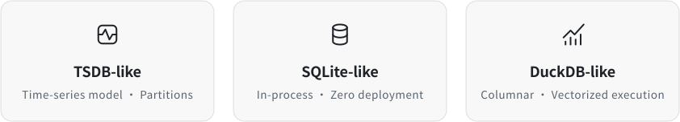
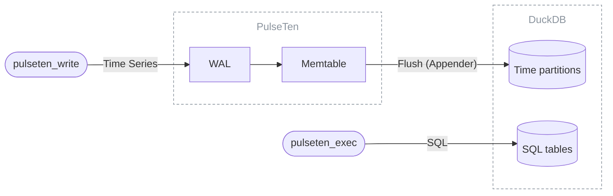
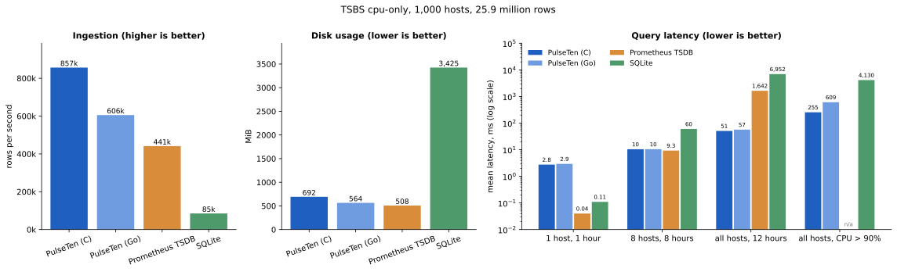

<div align="center">

<h1>PulseTen</h1>

<p><b>The embedded time-series database built on DuckDB.</b></p>

<p>
<a href="https://github.com/leviathan0992/pulseten/actions/workflows/ci.yml"></a>
<a href="LICENSE"></a>
</p>

<p>English | <a href="README.zh-CN.md">简体中文</a></p>

<br>



</div>

## Overview

PulseTen is an embedded time-series database built on [DuckDB](https://duckdb.org). Time-series data is written through a native time-series API, and SQL tables are read and written through SQL.

## Highlights

- **Time-series and SQL tables, one database.** Metrics are written to time-series tables through a native API; hosts, devices and other reference data live in SQL tables with ACID transactions. A single SQL query joins both, with no data movement.
- **Fast ingestion.** A write appends one batch to the write-ahead log and to a columnar memtable; a background thread flushes it into DuckDB in bulk.
- **Real-time.** Writes are queryable as soon as they return; every query reads stored and in-memory data as one consistent snapshot.
- **Time partitioning.** Time-series data is organized into hour-aligned partitions. Queries prune partitions outside their time range, and retention drops expired partitions whole.
- **Compact storage.** Flushed data is kept in DuckDB's columnar format, where each column is compressed with lightweight encodings such as RLE, bit-packing, dictionary/FSST and ALP for floating-point values.
- **Crash recovery.** Time-series writes are group-committed to a write-ahead log and replayed on open, so a process crash loses nothing. By default a power loss may lose the most recent writes; optional WAL sync makes each write durable before it returns.
- **Embeddable.** A single header and a self-contained static library. Ships with native Go bindings.

## When to Use

PulseTen fits when one application stores its own time-series data:

- metrics and sensor data on a server, a desktop, a gateway or a router;
- analytics over recent and historical data in the same query;
- time-series data joined with reference data in SQL tables.

It does not fit when:

- several processes or machines need the same database: a database directory can be open only once at a time, and a second open fails with `PULSETEN_LOCKED`;
- single points must be updated or deleted: time-series tables only grow, and old data leaves by retention or by dropping the table;
- the platform is Windows, which is not supported.

## Architecture



Time-series writes are appended to a write-ahead log and buffered in a columnar memtable, which a background thread flushes into hour-aligned DuckDB partitions in bulk, through DuckDB's Appender. SQL tables are native DuckDB tables. Each query runs in DuckDB against one consistent snapshot of the partitions, the SQL tables and the memtable.

## Performance

PulseTen is compared with Prometheus TSDB and SQLite on the TSBS `cpu-only` use case: 1,000 hosts reporting ten CPU usage fields every 10 seconds for 3 days, about 26 million rows. Each engine ingests the data in bulk, then answers queries over one host, a few hosts, and every host. The chart shows four of the 16 TSBS query types, chosen from those every engine answers.



See [docs/benchmark.md](docs/benchmark.md) for the setup and the full results, including all 16 query types at 100 and 1,000 hosts.

## Data Model

A **point** is one row of a time-series table:

| Part | Type | Example |
| --- | --- | --- |
| Table | | `cpu` |
| Time | Microseconds, UTC | `2026-01-01 00:00:00` |
| Tags | Strings that identify the source | `host=web-1` |
| Fields | BOOLEAN, BIGINT, DOUBLE or VARCHAR | `usage=12.5` |

A write creates its table if the table does not exist yet, and creates the columns it names for the first time. A table declared in advance with `pulseten_create_table` (Go: `CreateTable`) gets its columns from its first write. A column keeps its type; a write that gives it another type is rejected. In SQL, tags, fields and `time` are ordinary columns.

## Example

```cpp
#include "pulseten.h"

#include <cstdio>

int main() {
  pulseten_db_t *db = nullptr;
  pulseten_open("./metrics", nullptr, &db);

  /* cpu,host=web-1 usage=12.5 at 2026-01-01 00:00 UTC. The cpu table and
  its columns are created by the write itself. */
  pulseten_tag_t   tag   = {"host", 4, "web-1", 5};
  pulseten_field_t field = {"usage", 5, PULSETEN_TYPE_DOUBLE, {.m_double = 12.5}};
  pulseten_point_t point = {1767225600000000LL, &tag, 1, &field, 1};
  pulseten_write(db, "cpu", &point, 1);

  /* The write is visible to queries as soon as it returns. */
  pulseten_result_t *result = nullptr;
  pulseten_query(db,
                 "SELECT host, avg(usage) FROM cpu "
                 "WHERE time >= TIMESTAMP '2026-01-01' "
                 "GROUP BY host",
                 &result);

  uint32_t n = 0;
  while (pulseten_result_fetch(result, &n) == PULSETEN_OK && n > 0) {
    for (uint32_t r = 0; r < n; r++) {
      printf("%s %.2f\n", pulseten_result_varchar(result, 0, r, nullptr),
             pulseten_result_double(result, 1, r));
    }
  }

  pulseten_result_destroy(result);
  pulseten_close(db);

  return (0);
}
```

The same flow in Go:

```go
db, err := pulseten.Open("./metrics", nil)
if err != nil {
	return err
}
defer db.Close()

// The cpu table and its columns are created by the write itself.
if err := db.Write("cpu", pulseten.Point{
	Time:   time.Now(),
	Tags:   []pulseten.Tag{{Name: "host", Value: "web-1"}},
	Fields: []pulseten.Field{{Name: "usage", Value: 12.5}},
}); err != nil {
	return err
}

rows, err := db.Query(
	`SELECT host, avg(usage) FROM cpu WHERE time >= $1 GROUP BY host`,
	time.Now().Add(-time.Hour))
if err != nil {
	return err
}
defer rows.Close()

for rows.Next() {
	fmt.Println(rows.String(0), rows.Float64(1))
}
return rows.Err()
```

See [examples/quickstart.cc](examples/quickstart.cc) and [examples/quickstart.go](examples/quickstart.go) for complete programs with error handling.

## Installation

### Go

```bash
go get github.com/leviathan0992/pulseten/go
```

The package uses prebuilt static libraries of PulseTen and DuckDB, so neither is compiled. It requires Go 1.22+, and a C/C++ compiler to link the libraries, such as `g++` on Linux or the Xcode command line tools on macOS.

| Platform | Build command |
| --- | --- |
| macOS 12+ on Apple silicon | `go build` |
| Linux on x86-64 or ARM64, glibc | `go build` |
| Linux on x86-64 or ARM64, musl (such as Alpine) | `go build -tags pulseten_use_musl` |
| Others | [Build from source](#building-from-source) |

### C and C++

[Build from source](#building-from-source), then compile with the flags from pkg-config:

```bash
export PKG_CONFIG_PATH=/opt/pulseten/lib/pkgconfig
c++ -std=c++20 app.cc $(pkg-config --cflags --libs pulseten) -o app
```

## Building from Source

Building requires CMake 3.24+, Ninja and a C++20 compiler. Linux and macOS are tested.

```bash
git submodule update --init third_party/duckdb
cmake -S . -B build -G Ninja -DCMAKE_BUILD_TYPE=Release
cmake --build build && ctest --test-dir build
cmake --install build --prefix /opt/pulseten
```

This installs `pulseten.h` and `libpulseten.a`, a static library that includes DuckDB, with a CMake package (`PulseTen::pulseten`) and a pkg-config file (`pulseten.pc`).

To use this library from Go instead of the prebuilt ones, build with the tag `pulseten_use_pkgconfig`. Platforms without prebuilt libraries use it by default.

```bash
export PKG_CONFIG_PATH=/opt/pulseten/lib/pkgconfig
go build -tags pulseten_use_pkgconfig
```

## Documentation

- [include/pulseten.h](include/pulseten.h): the complete C API reference, covering durability, recovery, locking and memory limits.
- [go/](go): the Go package; run `go doc -all` there for its full API.
- [docs/benchmark.md](docs/benchmark.md): benchmark setup and full results.

## Status

PulseTen is in its 0.x series. Until 1.0, a minor release may change the API or the on-disk format; the release notes describe every such change.

## License

[Apache License 2.0](LICENSE)
