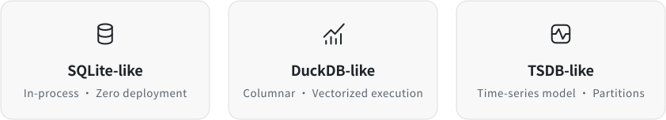

<div align="center">

<h1>PulseTen</h1>

<p><b>An Embedded Real-Time Analytical Database</b></p>

<p>English | <a href="README.zh-CN.md">简体中文</a></p>

<br>



</div>

## Overview

PulseTen is an embedded real-time analytical database. Like SQLite, it runs as a library inside the application process, with no server to deploy. Data is partitioned by time and stored in columns, and analytical queries are written in SQL and executed by [DuckDB](https://duckdb.org).

It is built for time-series data that is written continuously and analyzed right away: metrics, log statistics, device telemetry.

## Features

- **Durable and visible on write**: batches go to a write-ahead log with group commit. When a write returns `PULSETEN_OK`, it is durable and visible to every later query.
- **Schema-on-write**: tables and columns are created by the writes themselves, following a tag / field time-series data model.
- **Real-time analytics**: a query reads the columnar data on disk and the writes not yet flushed from memory, as one consistent snapshot.
- **Time partitions**: data is split into partitions of whole days, queries skip partitions outside their time range, and a retention period (TTL) drops expired partitions whole.
- **SQL analytics**: DuckDB executes a single read-only SELECT over logical tables, with CTEs, subqueries and joins. Table functions, qualified table names and internal or system objects are rejected; result types must fit the C API. Results are streamed chunk by chunk, and queries can be interrupted from another thread.
- **Plain C API**: a single header, `pulseten.h`, usable from C, C++ and any language that can call C. A Go package is in [go/](go).

## Building

Requires CMake 3.24 or later and a C++20 compiler (Clang or GCC). Tested on Linux and macOS. DuckDB is a submodule pinned to v2.0.0.

```bash
git submodule update --init third_party/duckdb
cmake -S . -B build -G Ninja -DCMAKE_BUILD_TYPE=Release
cmake --build build && ctest --test-dir build
```

## Installing

```bash
cmake --install build --prefix /opt/pulseten
```

This installs `pulseten.h` and a single static library, `libpulseten.a`, that includes DuckDB, together with a CMake package (`PulseTen::pulseten`) and a pkg-config file (`pulseten.pc`).

## Quick start

```cpp
#include <cstdio>

#include "pulseten.h"

int main() {
  pulseten_db_t *db = nullptr;
  pulseten_open("./metrics", nullptr, &db);

  /* One point: cpu,host=web-1 usage=12.5 */
  pulseten_tag_t   tag   = {"host", 4, "web-1", 5};
  pulseten_field_t field = {"usage", 5, PULSETEN_TYPE_DOUBLE, {.d = 12.5}};
  pulseten_point_t point = {1767225600000000LL, &tag, 1, &field, 1};
  pulseten_write(db, "cpu", &point, 1, nullptr);

  /* Query with SQL and read the result chunk by chunk. */
  pulseten_result_t *result = nullptr;
  pulseten_query(db, "SELECT host, avg(usage) FROM cpu GROUP BY host", &result);

  uint32_t n;
  while (pulseten_fetch(result, &n) == PULSETEN_OK && n > 0) {
    for (uint32_t r = 0; r < n; r++) {
      printf("%s %.2f\n", pulseten_get_varchar(result, 0, r, nullptr),
             pulseten_get_double(result, 1, r));
    }
  }

  pulseten_result_destroy(result);
  pulseten_close(db);

  return (0);
}
```

A complete example, with error handling, is in [examples/quickstart.cc](examples/quickstart.cc).

## Documentation

- [include/pulseten.h](include/pulseten.h): the C API, with every function documented.
- [go/](go): the Go package; `go doc` shows its API.

## License

[Apache License 2.0](LICENSE)
