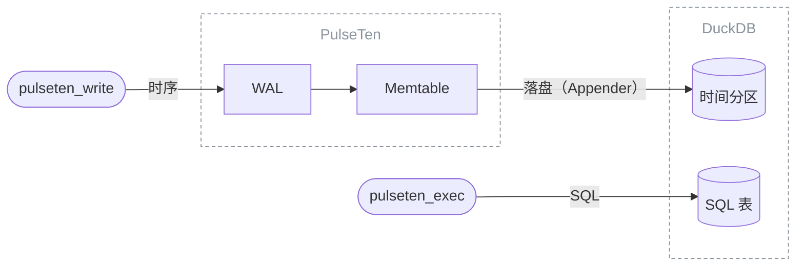
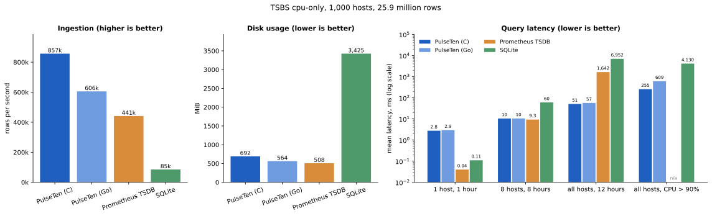

<div align="center">

<h1>PulseTen</h1>

<p><b>基于 DuckDB 的嵌入式时序数据库。</b></p>

<p>
<a href="https://github.com/leviathan0992/pulseten/actions/workflows/ci.yml"></a>
<a href="LICENSE"></a>
</p>

<p><a href="README.md">English</a> | 简体中文</p>

<br>


</div>

## 简介

PulseTen 是一个基于 [DuckDB](https://duckdb.org) 的嵌入式时序数据库。时序数据通过原生时序 API 写入，SQL 表通过 SQL 读写。与 SQLite 一样，它运行在应用进程内，无需额外部署服务。

## 亮点

- **时序表与 SQL 表，同一个数据库**：指标通过原生 API 写入时序表；主机、设备等维度数据存放在支持 ACID 事务的 SQL 表中。一条 SQL 即可关联两者，无需搬运数据。
- **写入快**：一次写入只需将一批数据追加到预写日志和列式 memtable，再由后台线程批量落盘到 DuckDB。
- **实时**：写入返回后即可查询；每条查询都在同一个一致性快照中读取已落盘和内存中的数据。
- **时间分区**：时序数据按小时对齐分区。查询自动裁剪时间范围之外的分区，过期分区按保留期整块删除。
- **紧凑存储**：落盘数据采用 DuckDB 的列式存储，每列按数据特征选用 RLE、位压缩、字典/FSST，以及针对浮点数的 ALP 等轻量编码。
- **崩溃恢复**：时序写入通过组提交记入预写日志（WAL），打开数据库时重放，进程崩溃不丢数据。默认情况下，断电可能丢失最近的写入；开启 WAL 同步后，每次写入在返回前完成持久化。
- **可嵌入**：一个头文件，一个自包含的静态库，并提供原生 Go 绑定。

## 架构



时序写入先追加到预写日志，再缓存在列式 memtable 中，由后台线程通过 DuckDB 的 Appender 批量落盘到按小时对齐的分区。SQL 表即原生 DuckDB 表。每条查询都在 DuckDB 中执行，读取分区、SQL 表和 memtable 的同一个一致性快照。

## 性能

PulseTen 与 Prometheus TSDB 和 SQLite 在 TSBS `cpu-only` 场景下进行了对比：1000 台主机每 10 秒上报 10 个 CPU 使用率指标，持续 3 天，共约 2600 万行。各引擎先批量写入，再分别查询单台主机、少量主机和全部主机。图中展示了 TSBS 16 类查询中的 4 类。



测试环境和完整结果见 [docs/benchmark.md](docs/benchmark.md)，包括 100 台和 1000 台主机下全部 16 类查询。

## 示例

```cpp
#include "pulseten.h"

#include <cstdio>

int main() {
  pulseten_db_t *db = nullptr;
  pulseten_open("./metrics", nullptr, &db);

  /* cpu,host=web-1 usage=12.5，时间为 2026-01-01 00:00 UTC。cpu 表及其列
  由这次写入自动创建。 */
  pulseten_tag_t   tag   = {"host", 4, "web-1", 5};
  pulseten_field_t field = {"usage", 5, PULSETEN_TYPE_DOUBLE, {.m_double = 12.5}};
  pulseten_point_t point = {1767225600000000LL, &tag, 1, &field, 1};
  pulseten_write(db, "cpu", &point, 1);

  /* 写入返回后即可被查询到。 */
  pulseten_result_t *result = nullptr;
  pulseten_query(db,
                 "SELECT host, avg(usage) FROM cpu "
                 "WHERE time >= TIMESTAMP '2026-01-01' "
                 "GROUP BY host",
                 &result);

  uint32_t n = 0;
  while (pulseten_result_fetch(result, &n) == PULSETEN_OK && n > 0) {
    for (uint32_t r = 0; r < n; r++) {
      printf("%s %.2f\n", pulseten_result_varchar(result, 0, r, nullptr),
             pulseten_result_double(result, 1, r));
    }
  }

  pulseten_result_destroy(result);
  pulseten_close(db);

  return (0);
}
```

在 Go 中是同样的流程：

```go
db, err := pulseten.Open("./metrics", nil)
if err != nil {
	return err
}
defer db.Close()

// cpu 表及其列由这次写入自动创建。
if err := db.Write("cpu", pulseten.Point{
	Time:   time.Now(),
	Tags:   []pulseten.Tag{{Name: "host", Value: "web-1"}},
	Fields: []pulseten.Field{{Name: "usage", Value: 12.5}},
}); err != nil {
	return err
}

rows, err := db.Query(`SELECT host, avg(usage) FROM cpu GROUP BY host`)
if err != nil {
	return err
}
defer rows.Close()

for rows.Next() {
	fmt.Println(rows.String(0), rows.Float64(1))
}
return rows.Err()
```

含错误处理的完整程序见 [examples/quickstart.cc](examples/quickstart.cc) 和 [examples/quickstart.go](examples/quickstart.go)。

## 安装

Go 包只需一条命令即可安装：

```bash
go get github.com/leviathan0992/pulseten/go
```

它链接预编译的静态库，不需要 CMake 和 pkg-config。编译需要 Go 1.22+、cgo，以及带有 C++ 标准库的 C 工具链。以下平台提供预编译库：

| 平台 | `GOOS/GOARCH` |
| --- | --- |
| macOS 12+，Apple 芯片 | `darwin/arm64` |
| Linux x86-64，glibc 或 musl | `linux/amd64` |
| Linux ARM64，glibc 或 musl | `linux/arm64` |

在 Alpine 等 musl 系统上，需要加上构建标签：

```bash
go build -tags pulseten_use_musl ./...
```

在其他平台上，以及在 C 和 C++ 中使用时，需要从源码构建。

## 从源码构建

需要 CMake 3.24+、Ninja 和支持 C++20 的编译器，已在 Linux 和 macOS 上测试。

```bash
git submodule update --init third_party/duckdb
cmake -S . -B build -G Ninja -DCMAKE_BUILD_TYPE=Release
cmake --build build && ctest --test-dir build
cmake --install build --prefix /opt/pulseten
```

安装后提供 `pulseten.h` 和 `libpulseten.a`（已打包 DuckDB 的自包含静态库），以及 CMake 包（`PulseTen::pulseten`）和 pkg-config 文件（`pulseten.pc`）。

如需让 Go 包链接自行构建的库，而不是预编译库，请使用构建标签 `pulseten_use_pkgconfig`。在没有预编译库的平台上，默认就采用这种方式。

```bash
export PKG_CONFIG_PATH=/opt/pulseten/lib/pkgconfig
go build -tags pulseten_use_pkgconfig ./...
```

## 文档

- [include/pulseten.h](include/pulseten.h)：完整的 C API 参考，涵盖持久性、恢复、锁和内存限制。
- [go/](go)：Go 包，在该目录下用 `go doc -all` 查看完整接口。
- [docs/benchmark.md](docs/benchmark.md)：测试方法和完整结果。

## 项目状态

PulseTen 目前处于 0.x 阶段。在 1.0 之前，次版本升级可能改变 API 或磁盘格式，每一处这样的变化都会写在发版说明中。

## 许可证

[Apache License 2.0](LICENSE)
