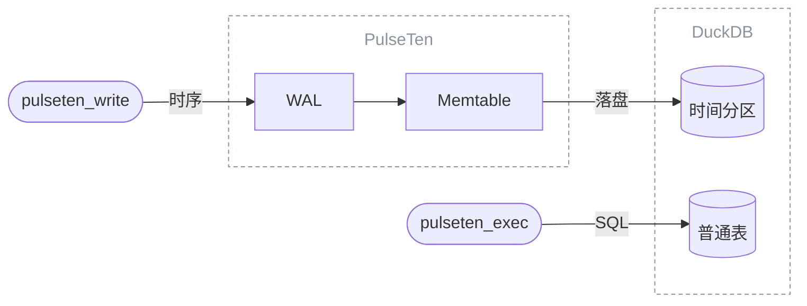

<div align="center">

<h1>PulseTen</h1>

<p><b>基于 DuckDB 的嵌入式时序数据库。</b></p>

<p>
<a href="https://github.com/leviathan0992/pulseten/actions/workflows/ci.yml"></a>
<a href="LICENSE"></a>
</p>

<p><a href="README.md">English</a> | 简体中文</p>

<br>


</div>

## 简介

PulseTen 是一个基于 [DuckDB](https://duckdb.org) 的嵌入式时序数据库。时序数据通过原生时序 API 写入，普通 DuckDB 表通过 SQL 接口读写。与 SQLite 一样，它运行在应用进程内，无需额外部署服务。

## 亮点

- **时序与关系数据**：指标写入时序表；主机、设备等维度数据存放在支持 ACID 事务的普通表中。两者可以直接关联查询，无需搬运数据。
- **实时**：写入返回后即可查询；每条查询都在同一个一致性快照中读取已落盘和内存中的数据。
- **时间分区**：时序数据按小时对齐分区。查询自动裁剪时间范围之外的分区，过期分区按保留期整块删除。
- **紧凑存储**：落盘数据采用 DuckDB 的列式存储，每列按数据特征选用 RLE、位压缩、字典/FSST，以及针对浮点数的 ALP 等轻量编码。
- **崩溃恢复**：时序写入通过组提交记入预写日志（WAL），打开数据库时重放。开启 WAL 同步后，每次写入在返回前完成持久化。
- **可嵌入**：一个头文件，一个自包含的静态库，并提供原生 Go 绑定。

## 架构



时序写入先追加到预写日志，再缓存在列式 memtable 中，由后台线程落盘到按小时对齐的 DuckDB 分区。普通表即原生 DuckDB 表。每条查询都在 DuckDB 中执行，读取分区、普通表和 memtable 的同一个一致性快照。

## 示例

```cpp
#include "pulseten.h"

#include <cstdio>

int main() {
  pulseten_db_t *db = nullptr;
  pulseten_open("./metrics", nullptr, &db);

  /* 关系数据存放在普通表中。 */
  pulseten_exec(db,
                "CREATE TABLE hosts (host VARCHAR PRIMARY KEY, region VARCHAR);"
                "INSERT INTO hosts VALUES ('web-1', 'us-east');");

  /* 时序数据：cpu,host=web-1 usage=12.5，时间为 2026-01-01 00:00 UTC。
  cpu 表及其列由这次写入自动创建。 */
  pulseten_tag_t   tag   = {"host", 4, "web-1", 5};
  pulseten_field_t field = {"usage", 5, PULSETEN_TYPE_DOUBLE, {.m_double = 12.5}};
  pulseten_point_t point = {1767225600000000LL, &tag, 1, &field, 1};
  pulseten_write(db, "cpu", &point, 1);

  /* 一条查询同时读取两者，包括刚刚写入的数据。 */
  pulseten_result_t *result = nullptr;
  pulseten_query(db,
                 "SELECT h.region, avg(c.usage) "
                 "FROM cpu c JOIN hosts h USING (host) "
                 "WHERE c.time >= TIMESTAMP '2026-01-01' "
                 "GROUP BY h.region",
                 &result);

  uint32_t n = 0;
  while (pulseten_result_fetch(result, &n) == PULSETEN_OK && n > 0) {
    for (uint32_t r = 0; r < n; r++) {
      printf("%s %.2f\n", pulseten_result_varchar(result, 0, r, nullptr),
             pulseten_result_double(result, 1, r));
    }
  }

  pulseten_result_destroy(result);
  pulseten_close(db);

  return (0);
}
```

在 Go 中是同样的流程：

```go
db, err := pulseten.Open("./metrics", nil)
if err != nil {
	return err
}
defer db.Close()

if err := db.Exec(`CREATE TABLE hosts (host VARCHAR PRIMARY KEY, region VARCHAR);
                   INSERT INTO hosts VALUES ('web-1', 'us-east');`); err != nil {
	return err
}

if err := db.Write("cpu", pulseten.Point{
	Time:   time.Now(),
	Tags:   []pulseten.Tag{{Name: "host", Value: "web-1"}},
	Fields: []pulseten.Field{{Name: "usage", Value: 12.5}},
}); err != nil {
	return err
}

rows, err := db.Query(`SELECT h.region, avg(c.usage)
                       FROM cpu c JOIN hosts h USING (host)
                       GROUP BY h.region`)
if err != nil {
	return err
}
defer rows.Close()

for rows.Next() {
	fmt.Println(rows.String(0), rows.Float64(1))
}
return rows.Err()
```

含错误处理的完整程序见 [examples/quickstart.cc](examples/quickstart.cc)。

## 构建

需要 CMake 3.24+、Ninja 和支持 C++20 的编译器，已在 Linux 和 macOS 上测试。

```bash
git submodule update --init third_party/duckdb
cmake -S . -B build -G Ninja -DCMAKE_BUILD_TYPE=Release
cmake --build build && ctest --test-dir build
cmake --install build --prefix /opt/pulseten
```

安装后提供 `pulseten.h` 和 `libpulseten.a`（已打包 DuckDB 的自包含静态库），以及 CMake 包（`PulseTen::pulseten`）和 pkg-config 文件（`pulseten.pc`）。

Go 包通过 pkg-config 链接该库：

```bash
export PKG_CONFIG_PATH=/opt/pulseten/lib/pkgconfig
go get github.com/leviathan0992/pulseten/go
```

## 文档

- [include/pulseten.h](include/pulseten.h)：完整的 C API 参考，涵盖持久性、恢复、锁和内存方面的保证。
- [go/](go)：Go 包，用 `go doc` 查看接口。

## 许可证

[Apache License 2.0](LICENSE)
