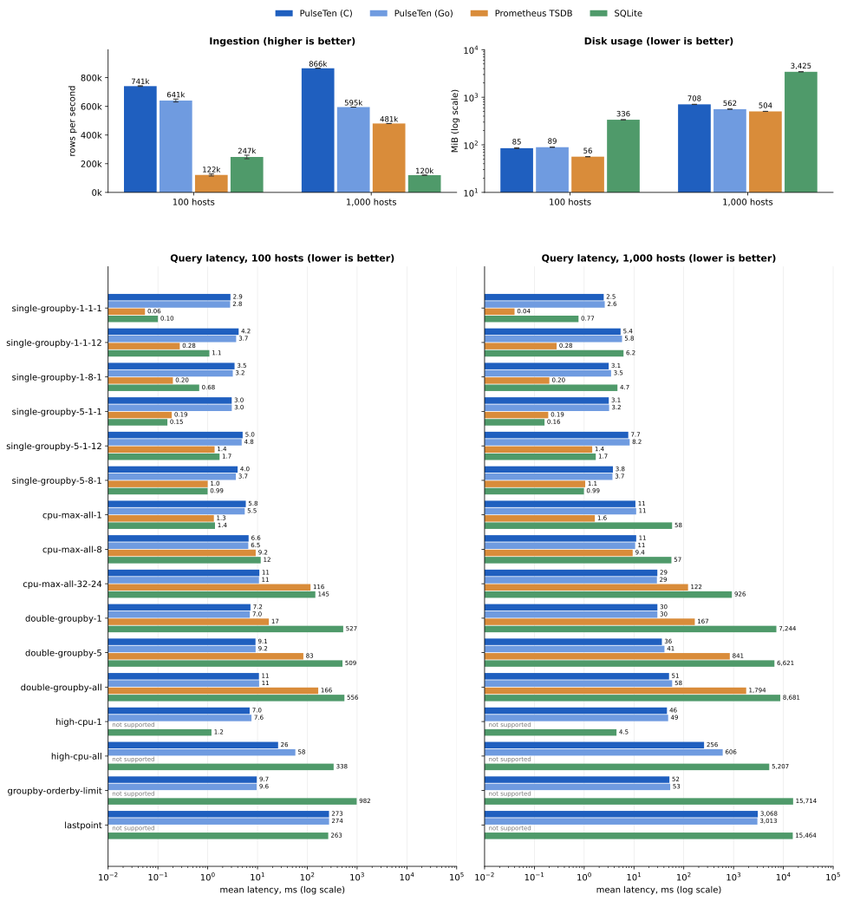

# Benchmark

This benchmark compares PulseTen with Prometheus TSDB and SQLite on the TSBS
`cpu-only` use case: host metrics from 100 and 1,000 hosts, each reporting ten
CPU usage fields every 10 seconds for 3 days. The data and the queries both
come from the TSBS generators, with a fixed seed. Each engine ingests the data
in bulk, then answers 20 queries of each of the 16 TSBS query types.

## Summary

- **Ingestion.** At 100 hosts PulseTen writes about 6 times as many rows per
  second as Prometheus TSDB and 3 times as many as SQLite through its C API. At
  1,000 hosts it writes 1.8 times as many as Prometheus TSDB through its C API
  and 1.2 times through its Go bindings, and 7 and 5 times as many as SQLite.
- **Disk usage.** Prometheus TSDB stores the data most compactly. PulseTen uses
  48% to 60% more at 100 hosts and 12% to 40% more at 1,000 hosts: about a
  quarter of SQLite's space at 100 hosts, and a sixth to a fifth at 1,000. Its
  size varies between runs.
- **Queries across many hosts.** At 1,000 hosts, on queries over 32 hosts or
  more except `lastpoint`, PulseTen answers 4 to 35 times faster than Prometheus
  TSDB. It is 20 to 300 times faster than SQLite through its C API and 9 to 290
  times through its Go bindings.
- **Single-host queries.** On the `single-groupby` queries of one host,
  Prometheus TSDB answers in 0.04 to 1.5 ms and SQLite in 0.1 to 6 ms, while
  PulseTen takes 2.5 to 8 ms. On `high-cpu-1` at 1,000 hosts PulseTen takes
  46 to 49 ms, against 4.5 ms for SQLite.
- **The latest row of every host.** PulseTen takes 3.0 to 3.1 s at 1,000 hosts,
  against 15.5 s for SQLite; at 100 hosts the two are close.

## Setup

### Engines

| Engine | Version | Interface | Layout |
| --- | --- | --- | --- |
| PulseTen | `main` branch | C API and Go bindings | 24-hour partitions |
| Prometheus TSDB | v0.316.0 | Go library with its PromQL engine | 2-hour head blocks, compacted up to 24 hours |
| SQLite | 3.54.1, through `mattn/go-sqlite3` | Go `database/sql` with prepared statements | One `WITHOUT ROWID` table keyed by `(hostname, time)`, and an index on `time` |

PulseTen runs twice, through its C API and through its Go bindings, so that it
also meets the two Go engines on their own terms. SQLite has the indexes TSBS
creates for TimescaleDB, and a 256 MiB page cache. DuckDB is left out: it is
where PulseTen keeps its data, not an alternative to it.

### Durability

Every engine acknowledges a write as soon as it reaches the operating system's
page cache, without waiting for `fsync`.

| Engine | Configuration |
| --- | --- |
| PulseTen | `m_wal_sync = 0`, the default, and `fsync_mode = 'NONE'` for its internal DuckDB |
| Prometheus TSDB | Default options, which do not sync commits |
| SQLite | `journal_mode = WAL` and `synchronous = OFF` |

Two engines still sync in the background, and neither offers a way to stop it.
PulseTen syncs its WAL before each flush, so that the log always covers what
storage holds; Prometheus syncs finished WAL segments and the blocks it writes
during compaction.

### Data

`tsbs_generate_data --use-case=cpu-only --seed=123`, 3 days from 2016-01-01
UTC at a 10-second interval. Each row carries ten tags, `hostname`, `region`,
`datacenter`, `rack`, `os`, `arch`, `team`, `service`, `service_version` and
`service_environment`, and ten integer fields, `usage_user` to
`usage_guest_nice`.

| Scale | Rows | Values |
| --- | --- | --- |
| 100 hosts | 2,592,000 | 25,920,000 |
| 1,000 hosts | 25,920,000 | 259,200,000 |

PulseTen and SQLite store the fields as 64-bit integers; Prometheus stores
every sample as a 64-bit float. Every engine reads the same pre-generated file,
and reading it is not timed.

### Ingestion

Rows arrive in time order, 10,000 at a time. A batch is one `pulseten_write`
call, one Prometheus appender commit, or one SQLite transaction. Prometheus
keeps each field of each host as a series of its own, so for it a batch holds
100,000 samples.

Prometheus compacts its head into a block once the head spans one and a half
blocks, the condition it uses in normal operation. Because 3 days of data
arrive here in under a minute, all of that compaction falls within the
measured ingestion instead of spreading over two-hour intervals.

Each run reports two times:

- **Ingest**: from the first write until the last one returns.
- **Stored**: until every row has reached its final storage and the database
  has closed. For PulseTen this includes the background flush into DuckDB, and
  for SQLite a WAL checkpoint.

### Queries

`tsbs_generate_queries` with the same seed generates 20 queries of each type.

| Query type | What it computes |
| --- | --- |
| `single-groupby-1-1-1` | Max of 1 field of 1 host, 1 hour, per minute |
| `single-groupby-1-1-12` | Max of 1 field of 1 host, 12 hours, per minute |
| `single-groupby-1-8-1` | Max of 1 field of 8 hosts, 1 hour, per minute |
| `single-groupby-5-1-1` | Max of 5 fields of 1 host, 1 hour, per minute |
| `single-groupby-5-1-12` | Max of 5 fields of 1 host, 12 hours, per minute |
| `single-groupby-5-8-1` | Max of 5 fields of 8 hosts, 1 hour, per minute |
| `cpu-max-all-1` | Max of every field of 1 host, 8 hours, per hour |
| `cpu-max-all-8` | Max of every field of 8 hosts, 8 hours, per hour |
| `cpu-max-all-32-24` | Max of every field of 32 hosts, 24 hours, per hour |
| `double-groupby-1` | Mean of 1 field of every host, 12 hours, per host and hour |
| `double-groupby-5` | Mean of 5 fields of every host, 12 hours, per host and hour |
| `double-groupby-all` | Mean of every field of every host, 12 hours, per host and hour |
| `high-cpu-1` | Rows of 1 host with `usage_user` above 90, 12 hours |
| `high-cpu-all` | Rows of every host with `usage_user` above 90, 12 hours |
| `groupby-orderby-limit` | Max of 1 field across every host per minute, the last 5 minutes before a random time |
| `lastpoint` | The latest row of every host |

PulseTen and SQLite run the SQL that TSBS generates for TimescaleDB, rewritten
for each dialect. Prometheus runs the PromQL that TSBS generates, as range
queries. Three adjustments make every engine compute the same result:

- Queries that group into time buckets have their start and end rounded down to
  a bucket boundary, and Prometheus evaluates each bucket 1 ms before it ends,
  so that SQL buckets and PromQL windows cover the same rows.
- PromQL drops the metric name inside functions and cannot group by it, so a
  query over several fields runs as one PromQL query per field, and the
  reported time is their sum.
- `high-cpu-*`, `groupby-orderby-limit` and `lastpoint` have no PromQL form in
  TSBS, so Prometheus answers 12 of the 16 types.

After ingestion the database is reopened and its files are read once, so that
every engine starts from a warm page cache. Each type then runs once untimed
and 20 times for measurement; the mean is reported.

Every result is checked against PulseTen through its C API, by row count and
the sum of its values. In every run, all 320 results from the Go bindings and
SQLite match, and so do all 240 from Prometheus.

### Environment

An Apple M1 with 8 cores and 16 GB of memory, running macOS 15.7.7, Apple clang
16.0.0 and Go 1.27.1. Each engine runs in-process, one at a time, on a desktop
with its usual applications open. The PulseTen results come from a later run
than those of Prometheus TSDB and SQLite, on the same machine with the same
data and queries. Each PulseTen run starts once the one-minute load average is
below 6.

## Results

The 100-host scale runs twice, shown as `first / second`; the 1,000-host scale
runs once.

### Ingestion

100 hosts:

| Engine | Rows per second | Ingest (s) | Stored (s) | Disk (MiB) |
| --- | --- | --- | --- | --- |
| PulseTen (C) | 738,799 / 743,688 | 3.5 / 3.5 | 4.3 / 4.3 | 83.4 / 86.9 |
| PulseTen (Go) | 650,908 / 630,349 | 4.0 / 4.1 | 4.8 / 4.9 | 88.6 / 89.9 |
| Prometheus TSDB | 128,926 / 115,000 | 20.1 / 22.5 | 20.1 / 22.6 | 56.3 / 56.3 |
| SQLite | 259,370 / 234,997 | 10.0 / 11.0 | 10.1 / 11.1 | 336.5 / 336.4 |

1,000 hosts:

| Engine | Rows per second | Ingest (s) | Stored (s) | Disk (MiB) |
| --- | --- | --- | --- | --- |
| PulseTen (C) | 865,758 | 29.9 | 32.7 | 707.6 |
| PulseTen (Go) | 594,977 | 43.6 | 45.1 | 562.4 |
| Prometheus TSDB | 480,512 | 53.9 | 54.0 | 504.1 |
| SQLite | 120,294 | 215.5 | 215.7 | 3,424.9 |

### Query latency

Mean latency over 20 queries, in milliseconds. A dash marks a query type with
no PromQL form.

100 hosts:

| Query type | PulseTen (C) | PulseTen (Go) | Prometheus TSDB | SQLite |
| --- | --- | --- | --- | --- |
| `single-groupby-1-1-1` | 3.1 / 2.6 | 2.6 / 3.1 | 0.07 / 0.04 | 0.10 / 0.10 |
| `single-groupby-1-1-12` | 4.4 / 4.0 | 3.7 / 3.7 | 0.27 / 0.28 | 1.1 / 1.1 |
| `single-groupby-1-8-1` | 3.6 / 3.3 | 3.2 / 3.2 | 0.20 / 0.20 | 0.69 / 0.66 |
| `single-groupby-5-1-1` | 3.2 / 2.8 | 3.1 / 3.0 | 0.19 / 0.19 | 0.16 / 0.15 |
| `single-groupby-5-1-12` | 5.3 / 4.8 | 5.0 / 4.7 | 1.4 / 1.4 | 1.8 / 1.7 |
| `single-groupby-5-8-1` | 4.1 / 3.9 | 3.6 / 3.8 | 1.0 / 0.99 | 0.99 / 1.0 |
| `cpu-max-all-1` | 5.7 / 5.9 | 5.8 / 5.3 | 1.3 / 1.4 | 1.4 / 1.4 |
| `cpu-max-all-8` | 6.5 / 6.8 | 7.0 / 6.1 | 9.2 / 9.2 | 12.1 / 11.2 |
| `cpu-max-all-32-24` | 10.7 / 11.1 | 10.9 / 10.5 | 115 / 117 | 144 / 146 |
| `double-groupby-1` | 6.7 / 7.8 | 7.4 / 6.7 | 16.7 / 17.0 | 458 / 595 |
| `double-groupby-5` | 9.2 / 9.0 | 9.6 / 8.7 | 82.5 / 84.0 | 494 / 524 |
| `double-groupby-all` | 10.3 / 11.1 | 11.2 / 10.4 | 164 / 167 | 538 / 575 |
| `high-cpu-1` | 7.0 / 6.9 | 7.6 / 7.5 | — | 1.2 / 1.2 |
| `high-cpu-all` | 25.9 / 26.0 | 57.1 / 58.0 | — | 339 / 338 |
| `groupby-orderby-limit` | 9.5 / 9.9 | 9.5 / 9.7 | — | 981 / 982 |
| `lastpoint` | 272 / 274 | 267 / 280 | — | 263 / 263 |

1,000 hosts:

| Query type | PulseTen (C) | PulseTen (Go) | Prometheus TSDB | SQLite |
| --- | --- | --- | --- | --- |
| `single-groupby-1-1-1` | 2.5 | 2.6 | 0.04 | 0.77 |
| `single-groupby-1-1-12` | 5.4 | 5.8 | 0.28 | 6.2 |
| `single-groupby-1-8-1` | 3.1 | 3.5 | 0.20 | 4.7 |
| `single-groupby-5-1-1` | 3.1 | 3.2 | 0.19 | 0.16 |
| `single-groupby-5-1-12` | 7.7 | 8.2 | 1.4 | 1.7 |
| `single-groupby-5-8-1` | 3.8 | 3.7 | 1.1 | 0.99 |
| `cpu-max-all-1` | 10.7 | 11.1 | 1.6 | 58.3 |
| `cpu-max-all-8` | 11.1 | 10.6 | 9.4 | 56.5 |
| `cpu-max-all-32-24` | 29.5 | 28.9 | 122 | 926 |
| `double-groupby-1` | 29.6 | 29.5 | 167 | 7,244 |
| `double-groupby-5` | 36.4 | 41.0 | 841 | 6,621 |
| `double-groupby-all` | 50.7 | 58.5 | 1,794 | 8,681 |
| `high-cpu-1` | 46.0 | 48.6 | — | 4.5 |
| `high-cpu-all` | 256 | 606 | — | 5,207 |
| `groupby-orderby-limit` | 51.5 | 53.4 | — | 15,714 |
| `lastpoint` | 3,068 | 3,013 | — | 15,464 |
